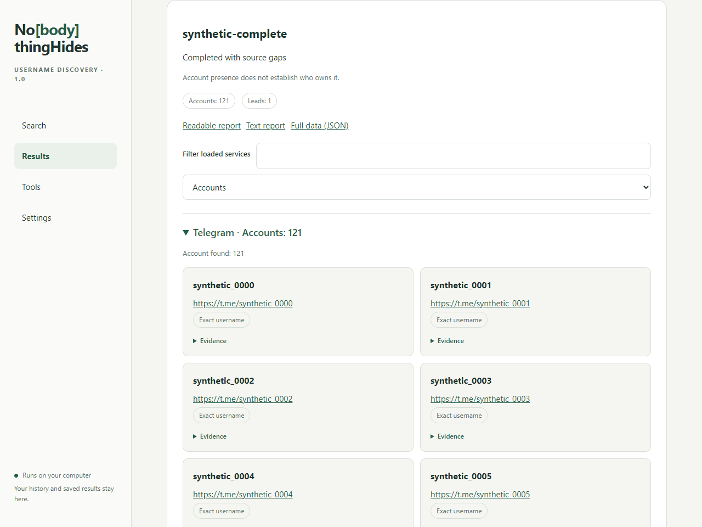

# No[body]thingHides

Local-first Windows software for researching public accounts from one username or nickname, with evidence-aware results, resumable jobs and service-grouped reports.


> **First public release: 1.0.0.** The project is useful and deliberately honest about uncertainty, but it is not a premium service, a universal directory or proof of account ownership.



## Author's note

I built this project as a vibe-coding experiment with GPT-6.1-Sol, open-source libraries and upstream projects listed in the license notices. I do not claim to understand every internal module completely, and this release has real limitations, incomplete provider coverage and possible defects. Please do not treat it as a premium or infallible product.

Even with those limits, we built a strong open project for username and nickname research. The public client, contracts and documentation are available to inspect and extend. You may use them as a foundation within the terms of `LICENSE`; keep attribution to No[body]thingHides and preserve the licenses of upstream components when reusing any part.

The project will continue to evolve. Face/avatar research and authorized phone-identifier workflows are possible future directions. They are **not implemented in 1.0.0** and have no promised coverage or delivery date.

## Engineering note

The first release passed the declared source, client and installed-package checks, but those checks do not establish catalogue-wide recall, stable access to every external service, fresh-OS coverage or common-human ownership of matching accounts. Provider blocks, rate limits, login walls, robots rules and unavailable APIs remain visible gaps. A report is an evidence-labelled research result, not an automatic identity decision.

## What it does

- Enter one nickname once and choose **Quick** or **Deep**.
- Quick selects popular supported services; Deep uses the full eligible catalogue.
- Both modes run the same applicable discovery, extraction and verification stages.
- Stop a job, keep its checkpoint and continue it later with the remaining request budget.
- Review accounts grouped by service, source status, evidence references and technical check details.
- Export readable HTML, text and JSON reports.
- Use the English interface or switch to the Russian interface.
- Keep investigation data local by default; no hosted account is required for the main workflow.

## Download and run

1. Open the repository's **Releases** page and download `NoBodyThingHides-1.0.0-windows-x64.zip`.
2. Verify the SHA-256 value shown in the release notes.
3. Extract the complete archive into a new folder.
4. Run `Start.cmd`.
5. Select English or Russian, enter a nickname without `@`, then choose Quick or Deep.

The portable release targets Windows 11 x64. Python, `uv` and Git are not required for users. Runtime data is created in the user's local workspace; the archive contains no previous reports, databases, cookies or credentials.

See [Quick start](docs/quick-start.md), [Russian quick start](docs/ru/quick-start.md) and [result interpretation](docs/results.md).

## Read results correctly

An account being present on a service is not proof that it belongs to the person you have in mind. Published profile links are declarations by a source, not ownership proof. Similar spellings and different accounts remain separate records.

The application keeps `FOUND`, `NOT_FOUND`, `UNKNOWN`, `BLOCKED`, `RATE_LIMITED`, `UNVERIFIED`, `NOT_CHECKED` and partial states distinct. An inaccessible provider is not silently converted into an absence claim.

Read [Result interpretation](docs/results.md) before relying on a report. Read [Limitations](docs/limitations.md) for the current provider and ownership boundaries.

## Public source boundary

This repository contains the public client, versioned release contracts, documentation and synthetic client tests. The official Windows release also contains a compiled private engine and its reviewed runtime dependencies. The public source builds the client; it does not rebuild the private engine.

That boundary is intentional for the 1.0.0 release. The original-material license therefore differs from a conventional OSI open-source license. Third-party code, datasets and runtime components keep their own licenses; see [NOTICE](NOTICE.md), [third-party attribution](docs/third-party.md) and the matching files in the Windows package.

## For contributors

Useful contributions include client fixes, accessibility improvements, English/Russian wording corrections, contract tests, documentation and reproducible synthetic bugs.

```text
python scripts/build_client.py
python -m unittest discover -s tests
node --check client/app.js
```

Read [CONTRIBUTING](CONTRIBUTING.md), [CONTRIBUTION_TERMS](CONTRIBUTION_TERMS.md) and [SUPPORT](SUPPORT.md) before opening an issue or pull request. Never attach credentials, cookies, raw evidence, personal investigations or an entire case folder.

## Privacy and responsible use

Use only public or owner-authorized sources and follow each provider's rules. Do not bypass login, CAPTCHA, access controls, robots restrictions or rate limits. Keep the local interface bound to the same computer and review every report before sharing it: reports can contain personal information from the sources you queried.

Read [Privacy](docs/privacy.md) and [Security](SECURITY.md). Security reports should not include secrets or personal investigation data.

## Roadmap

The public roadmap is intentionally cautious. Future work may explore face/avatar inputs, authorized phone-identifier workflows, more provider contracts, stronger fresh-OS acceptance and better contributor tooling. Each item needs a separate privacy, legal and technical review before it becomes a product claim.

See [Roadmap](docs/roadmap.md) for the current status. Planned work is not shipped functionality.

## Repository map

```text
client/                     Public HTML/CSS/JavaScript interface
client/locales/             English and Russian UI strings
contracts/release-v1/       Versioned client/core JSON contracts
docs/                       User, developer, privacy and verification docs
scripts/build_client.py     Deterministic public client build
tests/                      Synthetic public client tests
.github/                    CI, issue forms and pull request guidance
```

## License

Original No[body]thingHides material is provided under the [Freeware and Limited Source License 1.0](LICENSE). It permits free use and inspection of the published client and documentation, subject to the distribution and attribution terms in that license.

Third-party software and datasets are not relicensed by this project. Preserve their notices and source obligations. See [NOTICE](NOTICE.md) and [third-party attribution](docs/third-party.md).

## Status

Version `1.0.0` is the first public release. Service availability changes independently of application releases. Bugs, source restrictions and incomplete checks may occur; include the version and a small synthetic reproduction when reporting one.
